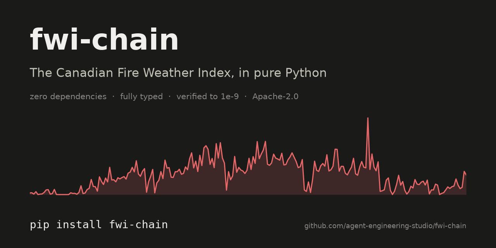
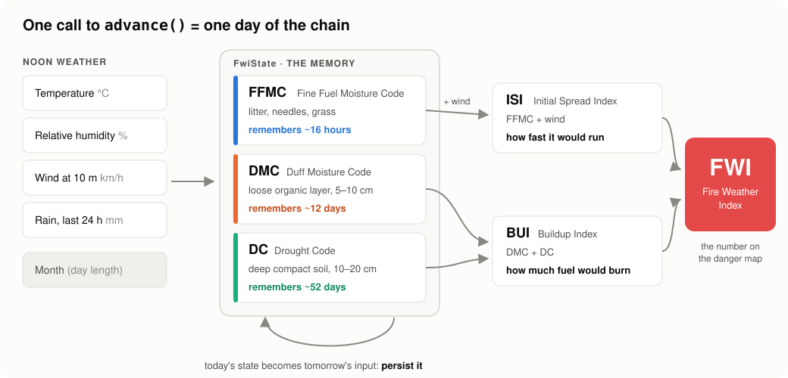
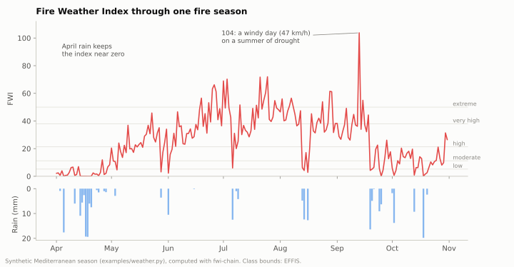
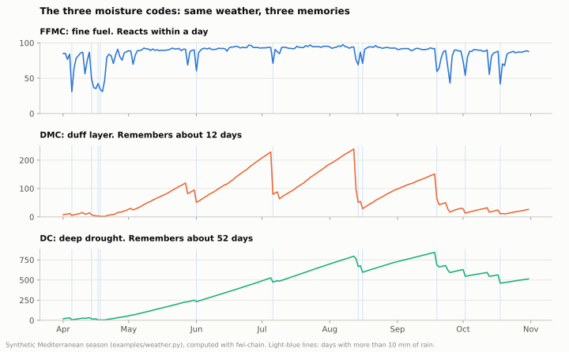
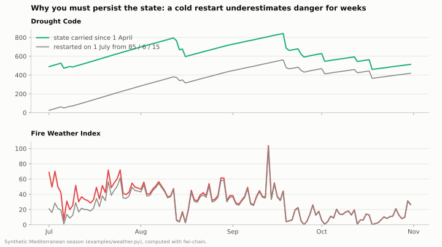

<p align="center">
  
</p>

<p align="center">
  <a href="https://github.com/agent-engineering-studio/fwi-chain/actions/workflows/ci.yml"></a>
  <a href="https://pypi.org/project/fwi-chain/"></a>
  
  
  
  <a href="./LICENSE"></a>
</p>

# fwi-chain

**The Canadian Forest Fire Weather Index (FWI) System as small, pure, typed Python functions.**
It has no dependencies and is verified against the published reference day to 1e-9.

Give it the weather at noon and it tells you how easily a wildfire would start, how
fast it would spread, and how hard it would be to fight. That is the same index
that national fire services and the European Forest Fire Information System (EFFIS)
publish every day.

```bash
pip install fwi-chain
```

---

## Contents

- [What is the Fire Weather Index?](#what-is-the-fire-weather-index)
- [Quick start](#quick-start)
- [See it in action](#see-it-in-action)
- [Why fwi-chain](#why-fwi-chain)
- [Examples](#examples)
- [Documentation](#documentation)
- [Contributing](#contributing)
- [Reference and citation](#reference-and-citation)

---

## What is the Fire Weather Index?

The FWI System was developed by the Canadian Forest Service (Van Wagner, 1987) and is
now the most widely used fire danger rating system in the world. It takes **four
weather readings at local noon**:

| Input | Unit |
|---|---|
| Air temperature | °C |
| Relative humidity | % |
| Wind speed at 10 m | km/h |
| Rain over the previous 24 hours | mm |

From these it computes **six numbers**:

<p align="center">
  
</p>

| Code | Name | What it tracks | Memory |
|------|------|----------------|--------|
| **FFMC** | Fine Fuel Moisture Code | dryness of litter, needles and grass: *will a spark catch?* | ~16 hours |
| **DMC**  | Duff Moisture Code | dryness of the loose organic layer below | ~12 days |
| **DC**   | Drought Code | deep, seasonal drought in compact organic soil | ~52 days |
| **ISI**  | Initial Spread Index | FFMC × wind: *how fast would it run?* | — |
| **BUI**  | Buildup Index | DMC + DC: *how much fuel is there to burn?* | — |
| **FWI**  | Fire Weather Index | ISI + BUI: *how intense would the fire be?* | — |

The key idea is that **the three moisture codes have memory**. Today's value depends
on yesterday's, so the FWI is a *chain* that runs day after day through the
fire season. `fwi-chain` makes that memory an explicit value (`FwiState`) that
you store wherever you like.

> New to fire weather? Read **[How the FWI works, in plain words](docs/how-fwi-works.md)**.

## Quick start

```python
from fwi_chain import STANDARD_PARAMS, advance

state = STANDARD_PARAMS.initial_state  # FFMC/DMC/DC = 85 / 6 / 15, the spring start-up

out = advance(
    state,
    month=4,
    temperature_c=17.0,
    relative_humidity_pct=42.0,
    wind_speed_kmh=25.0,
    rain_24h_mm=0.0,
    params=STANDARD_PARAMS,
)

print(round(out.fwi, 2))  # 10.1
state = out.state  # store it: tomorrow starts from here
```

A whole season is just a loop:

```python
state = STANDARD_PARAMS.initial_state
for day in noon_observations:  # your weather, one row per day, in order
    out = advance(
        state,
        month=day.month,
        temperature_c=day.temp,
        relative_humidity_pct=day.rh,
        wind_speed_kmh=day.wind,
        rain_24h_mm=day.rain,
        params=STANDARD_PARAMS,
    )
    state = out.state  # the chain: today's output, tomorrow's input
    print(day.date, round(out.fwi, 1))
```

Each of the six equations is also exported on its own (`fine_fuel_moisture_code`,
`duff_moisture_code`, `drought_code`, `initial_spread_index`, `buildup_index`,
`fire_weather_index`), so you can ask what-if questions directly. See the
[API reference](docs/api.md).

## See it in action

Every chart below is computed by `fwi-chain` itself from a synthetic, reproducible
Mediterranean season. Regenerate them with `make figures`.

**A fire season, day by day.** Spring rain keeps the index low. Through the summer,
drought builds up, and one windy September day pushes the FWI past 100.



**Three memories.** The same weather drives all three moisture codes, but they forget
at very different speeds. FFMC jumps back within a day of rain. The Drought Code
climbs slowly all summer and keeps its memory for weeks.



**Why the state matters.** Restart the chain on 1 July from the spring default codes
and it underestimates the danger for weeks, because it has "forgotten" a dry
spring. That is why `fwi-chain` hands you the state instead of hiding it.



## Why fwi-chain

- **Zero dependencies, scalar, pure.** No NumPy, no xarray, no I/O, no clock. It fits
  in a database job, a stream processor, or a serverless function. For gridded climate data, [xclim](https://github.com/Ouranosinc/xclim)'s
  vectorised FWI is the better tool.
- **The state is explicit.** One call is one day. You choose how to persist and resume
  the chain (a table, a file, a cache), instead of having it hidden in an array dimension.
- **Verified, not just tested.** The suite checks all six outputs of the reference day
  from the `cffdrs` test series to an absolute 1e-9. It also covers every rain branch,
  physical bounds under extreme weather, and the memory asymmetry between FFMC and DC.
  See [Validation](docs/validation.md).
- **Readable.** About 300 lines, with every line tied to an equation number in
  Van Wagner's report. It works as a reference implementation as well as a library.
- **Typed.** Ships `py.typed` and passes `mypy --strict`. Frozen dataclasses, keyword-only
  arguments, and units in every parameter name (`wind_speed_kmh`, `rain_24h_mm`).

`fwi-chain` was extracted from [Limen](https://github.com/agent-engineering-studio/limen),
where it runs the wildfire danger chain for every ~9 km weather node in Italy.

## Examples

Runnable, dependency-free scripts live in [`examples/`](examples/). CI runs every one
of them, so they always match the code.

| Script | What it shows |
|---|---|
| [`01_single_day.py`](examples/01_single_day.py) | One day of the chain, all six outputs explained |
| [`02_fire_season.py`](examples/02_fire_season.py) | A full season, danger classes, CSV export |
| [`03_daily_job_sqlite.py`](examples/03_daily_job_sqlite.py) | A daily job that persists the state in SQLite and resumes |
| [`04_many_stations.py`](examples/04_many_stations.py) | One state per station or grid cell, as in production |
| [`05_southern_hemisphere.py`](examples/05_southern_hemisphere.py) | Custom `FwiParams` for other latitudes |
| [`06_individual_equations.py`](examples/06_individual_equations.py) | What-if analysis with the individual equations |

```console
$ python examples/02_fire_season.py
214 days, 2026-04-01 to 2026-10-31
Peak FWI 103.76 on 2026-09-13 (wind 47.4 km/h)
Days per danger class:
  very low     39  ###################
  low          21  ##########
  moderate     33  ################
  high         64  ################################
  very high    34  #################
  extreme      23  ###########
```

## Documentation

| Guide | For whom |
|---|---|
| [How the FWI works](docs/how-fwi-works.md) | Everyone: the science in plain words, with pictures |
| [Getting started](docs/getting-started.md) | Developers: from `pip install` to a daily job, plus common mistakes |
| [Cookbook](docs/cookbook.md) | Recipes: pandas, CSV, SQLite, many stations, parallelism, units, HTTP service |
| [API reference](docs/api.md) | Every public function and class |
| [Validation](docs/validation.md) | How correctness is checked, and how to check it yourself |
| [FAQ](docs/faq.md) | Short answers to common questions |

## Contributing

**Contributions are very welcome**, whether you are a fire scientist, a meteorologist,
a Python developer, or someone who writes clear docs. Some ideas:

- 🔬 Add more reference vectors from the `cffdrs` test series
- 🌍 Contribute day-length tables for other latitude bands
- 📈 Implement the Daily Severity Rating, hourly FFMC, or DC overwintering
- 📝 Improve the docs, translate them, or write a tutorial for your region
- 🐛 Report anything that disagrees with a reference implementation

Start with **[CONTRIBUTING.md](CONTRIBUTING.md)**. It covers a five-minute dev setup,
the project layout, and a list of good first issues.

## Reference and citation

Van Wagner, C.E. (1987). *Development and structure of the Canadian Forest Fire Weather
Index System*. Canadian Forestry Service, Forestry Technical Report 35. The equation
numbers in the source comments are that report's.

If `fwi-chain` helps your work, a link back or a ⭐ on GitHub helps other people find it.

## License

[Apache-2.0](./LICENSE).
