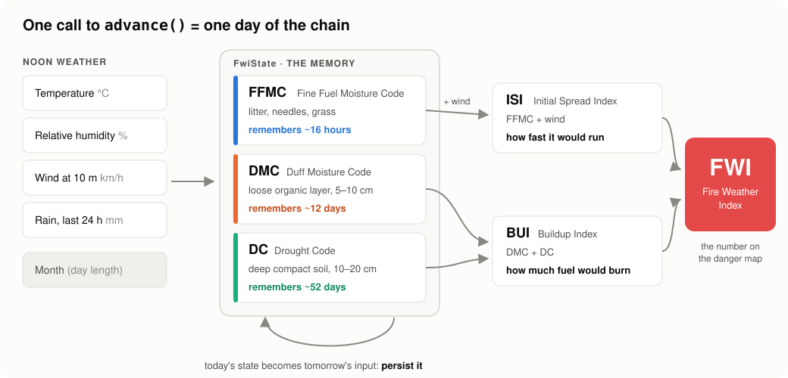

# fwi-chain documentation



| Start here if you… | Read |
|---|---|
| have never heard of the Fire Weather Index | [How the FWI works, in plain words](how-fwi-works.md) |
| want to compute your first FWI | [Getting started](getting-started.md) |
| have a specific task (pandas, SQL, many stations, an API…) | [Cookbook](cookbook.md) |
| need the exact signature of a function | [API reference](api.md) |
| want to know whether you can trust the numbers | [Validation](validation.md) |
| have a quick question | [FAQ](faq.md) |
| want to help | [Contributing](https://github.com/agent-engineering-studio/fwi-chain/blob/main/CONTRIBUTING.md) |
| want to share the project | [Social media kit](social-kit.md) |

Runnable scripts are in [`examples/`](https://github.com/agent-engineering-studio/fwi-chain/blob/main/examples/).

## Regenerating the figures

Every chart in these docs is computed by `fwi-chain` from the synthetic season in
[`examples/weather.py`](https://github.com/agent-engineering-studio/fwi-chain/blob/main/examples/weather.py):

```bash
make figures   # = uv run --with matplotlib python docs/scripts/make_figures.py
```

matplotlib is used only by this script and is never a dependency of the package.
The output is deterministic, so a figure changes in a diff only if the numbers changed.
