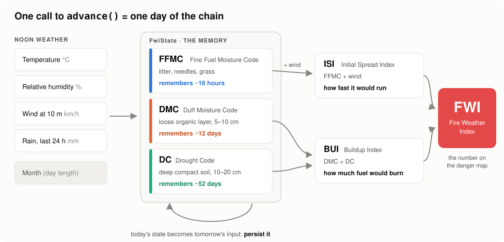
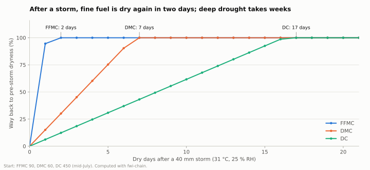
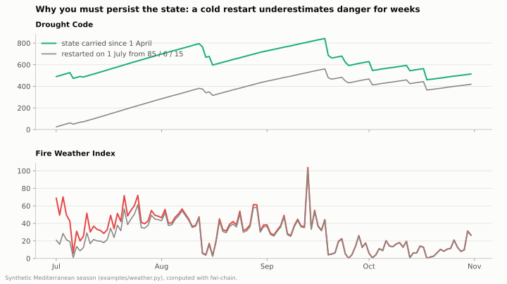
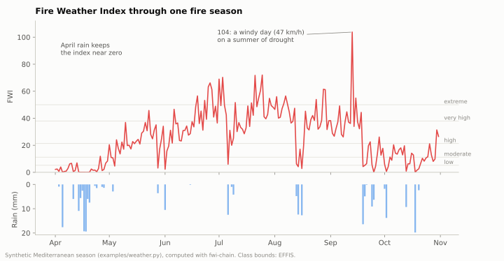

# How the Fire Weather Index works, in plain words

This page explains the Canadian Forest Fire Weather Index (FWI) System without
assuming any background in fire science. It covers what each number means,
why the system is a *chain*, and how `fwi-chain` turns it into code.



## The question the FWI answers

On any given day, a forest manager wants to know:

1. *If a fire started today, would it catch?*
2. *How fast would it spread?*
3. *How much fuel would it consume, and how hard would it be to put out?*

The answers depend on how **dry** the fuels on the forest floor are. Dryness
depends on the weather of today, but also of the past days, weeks and months.
A forest after a dry summer burns very differently from the same forest after
a wet one, even under identical weather today.

The FWI System, published by C.E. Van Wagner for the Canadian Forest Service in
1987, answers these questions with **six numbers** computed from **four weather
readings** taken every day at local noon.

## The inputs: four noon readings

| Input | Unit | Notes |
|---|---|---|
| Temperature | °C | Air temperature at local standard noon |
| Relative humidity | % | At noon, 0–100 |
| Wind speed | km/h | At 10 m height, at noon. Convert m/s × 3.6 |
| Rain | mm | Accumulated over the previous 24 hours (noon to noon) |

Plus the **month**, which sets the day length. Longer days dry the deeper
fuel layers faster.

> Why noon? The system was calibrated on noon observations, which are a good
> proxy for the mid-afternoon peak of fire danger. Feeding it daily maxima or
> daily means will give different, uncalibrated numbers.

## Three layers of fuel, three memories

Imagine digging into a forest floor. You go through three layers, and each one
dries at its own speed.

| Layer | Code | Typical depth | Time to lose ~2/3 of its excess moisture |
|---|---|---|---|
| Litter: dead needles, leaves, grass | **FFMC** (Fine Fuel Moisture Code) | top 1–2 cm | **~16 hours** |
| Duff: loose, decomposing organic matter | **DMC** (Duff Moisture Code) | 5–10 cm | **~12 days** |
| Deep, compact organic soil | **DC** (Drought Code) | 10–20 cm | **~52 days** |

Each code is a **number where higher means drier**:

- **FFMC** runs from 0 to 101. Above ~85 fine fuels ignite easily, and above ~90
  almost any spark will catch.
- **DMC** starts near 0 after snowmelt and can pass 100 in a dry summer.
- **DC** starts near 15 in spring and can pass 600–800 in a long drought.

### Rain has to get through the canopy first

Light rain is caught by the trees and never reaches the fuel. Each code
has a threshold below which rain is ignored:

| Code | Rain ignored below |
|---|---|
| FFMC | 0.5 mm |
| DMC | 1.5 mm |
| DC | 2.8 mm |

### The memory, visualised

The chart below starts from mid-summer conditions, adds a 40 mm storm, then
follows three weeks of hot, dry days. It shows how much of the storm's wetting
each code has "undone".



- **FFMC** is back to pre-storm dryness in **2 days**. Fine fuel reacts to today.
- **DMC** takes about **a week**.
- **DC** takes **more than two weeks**, and it would take longer outside July.
  That is why a summer drought keeps fires deep-burning even after a rainy day.

## Why it is a chain

Each moisture code is computed **from yesterday's value plus today's weather**:

```
FFMC(today) = f(FFMC(yesterday), temperature, humidity, wind, rain)
DMC(today)  = g(DMC(yesterday),  temperature, humidity, rain, month)
DC(today)   = h(DC(yesterday),   temperature, rain, month)
```

So you cannot compute the FWI for 15 August from 15 August's weather alone.
You need the whole season leading up to it. That is what "chain" means, and
it has a practical consequence: **you must store the state** (the three codes)
from one day to the next.

At the start of the season (after snowmelt, or in early spring in climates
without snow) the chain starts from standard values: **FFMC 85, DMC 6, DC 15**.
These are `STANDARD_PARAMS.initial_state`. They are deliberately "neutral", and
the codes need weeks of real weather before they mean much. The next chart shows
what happens if you restart from them in the middle of summer:



The restarted chain (grey) underestimates the Drought Code by 95 to 465 points
for the rest of the season, and the FWI by up to 48 points in the first weeks.
**Never restart a chain mid-season.** Persist the state instead (see the
[cookbook](cookbook.md#persist-the-state-between-runs)).

## From codes to indices

The three codes are combined into three indices:

### ISI: Initial Spread Index, *how fast would it run?*

ISI combines **FFMC** with **wind**. Wind is the single biggest driver of spread
rate: at FFMC 92, going from calm to 40 km/h multiplies ISI by more than seven.

```
wind (km/h)   0    10    20    30    40    50    60
ISI          5.7   9.4  15.6  25.8  42.8  70.8 117.2
```

### BUI: Buildup Index, *how much fuel is there to burn?*

BUI combines **DMC** and **DC**. It answers how much of the fuel bed is dry
enough to burn, which also predicts how hard a fire will be to mop up.

### FWI: Fire Weather Index, *how intense would the fire be?*

FWI combines **ISI** and **BUI** into the single number that goes on fire danger
maps. It is unbounded in principle. In practice, values above 50 are extreme
in most of Europe, and Canadian and Australian summers can reach 100 or more.

## Danger classes

The FWI is a continuous number. Agencies translate it into classes calibrated
for their region. EFFIS, for example, uses these for Europe:

| Class | FWI |
|---|---|
| Very low | < 5.2 |
| Low | 5.2 – 11.2 |
| Moderate | 11.2 – 21.3 |
| High | 21.3 – 38.0 |
| Very high | 38.0 – 50.0 |
| Extreme | ≥ 50.0 |

`fwi-chain` deliberately does **not** include classes. They are a regional,
policy-level choice, and [example 02](../examples/02_fire_season.py) shows how
to add your own in five lines.



## A worked example by hand

The Drought Code on a dry day is simple enough to check with a pencil. Start
from DC = 15 on an April day at 17 °C with no rain. Van Wagner's Eq. 22 gives
the potential evapotranspiration, with the April day-length factor 0.9:

```
PE = (0.36 × (T + 2.8) + Lf) / 2
   = (0.36 × (17 + 2.8) + 0.9) / 2
   = 4.014

DC(today) = DC(yesterday) + PE = 15 + 4.014 = 19.014
```

And the library agrees:

```python
>>> from fwi_chain import drought_code
>>> drought_code(15.0, temperature_c=17.0, rain_24h_mm=0.0, day_length=0.9)
19.014
```

That is exactly the DC of the reference day in [Validation](validation.md).

## How the code maps to the science

Every function in [`src/fwi_chain/chain.py`](../src/fwi_chain/chain.py) is
annotated with the equation numbers of Van Wagner (1987):

| Function | Equations | Inputs |
|---|---|---|
| `fine_fuel_moisture_code` | 1–10 | previous FFMC, T, RH, wind, rain |
| `duff_moisture_code` | 11–17 | previous DMC, T, RH, rain, day length |
| `drought_code` | 18–23 | previous DC, T, rain, day length |
| `initial_spread_index` | 24–26 | FFMC, wind |
| `buildup_index` | 27–28 | DMC, DC |
| `fire_weather_index` | 29–31 | ISI, BUI |
| `advance` | all | yesterday's `FwiState` + today's weather |

## Further reading

- Van Wagner, C.E. (1987). *Development and structure of the Canadian Forest Fire
  Weather Index System*. Forestry Technical Report 35, Canadian Forestry Service.
- Natural Resources Canada, *Canadian Wildland Fire Information System*:
  background on the FWI System.
- EFFIS, *European Forest Fire Information System*: daily FWI forecasts for Europe.
- [`cffdrs`](https://cran.r-project.org/package=cffdrs): the reference R implementation.
