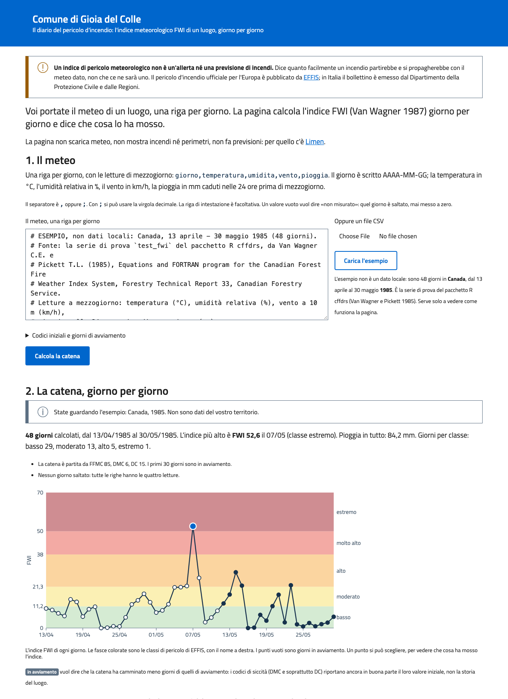
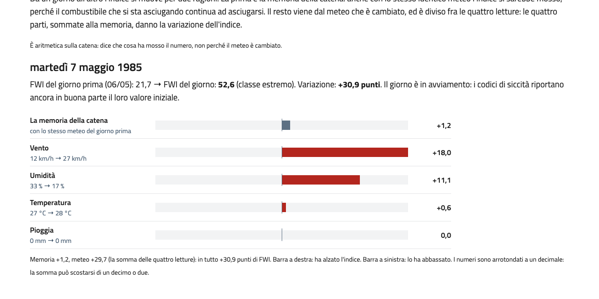

# Riuso nella Pubblica Amministrazione

fwi-chain calcola l'indice meteorologico di pericolo d'incendio (Fire Weather
Index, Van Wagner 1987). Questa pagina è per un ente che vuole usarla: che
cosa trova pronto, che cosa resta a lui.

!!! warning "Un indice di pericolo non è un'allerta"
    Dice quanto facilmente un incendio partirebbe e si propagherebbe con quel
    meteo, non che un incendio ci sarà. Il pericolo ufficiale in Europa è
    pubblicato da [EFFIS](https://forest-fire.emergency.copernicus.eu/); in
    Italia il bollettino di previsione incendi è del Dipartimento della
    Protezione Civile e delle Regioni.

## Il diario del pericolo d'incendio

Una pagina pronta, in italiano, con
[Bootstrap Italia](https://italia.github.io/bootstrap-italia/) servito dalla
pagina stessa, senza CDN:

- l'ente incolla o carica il meteo di mezzogiorno di una località, un giorno
  per riga: temperatura, umidità, vento, pioggia delle 24 ore;
- la pagina mostra la catena giorno per giorno: i sei codici, la classe di
  pericolo EFFIS, il grafico;
- scelto un giorno, dice **che cosa ha mosso l'indice**: la memoria della
  catena e i punti spostati da vento, umidità, temperatura e pioggia;
- segna i giorni in cui la catena è ancora in avviamento;
- esporta la tabella in CSV.





Nelle immagini c'è l'esempio incluso: 48 giorni in Canada nel 1985, la serie di
prova di `cffdrs`. Non sono dati di un territorio italiano.

```bash
FWI_CHAIN_ENTE="Comune di Gioia del Colle" docker compose up ui
# http://localhost:3007
```

Le istruzioni sono in
[`app/README.md`](https://github.com/agent-engineering-studio/fwi-chain/tree/main/app).

## Che cosa non fa

- **Non scarica il meteo.** Lo porta l'ente: dalla sua stazione, o da una
  fonte aperta (qui sotto).
- **Non mostra incendi, perimetri o previsioni.** Il monitoraggio è un altro
  progetto, [Limen](https://github.com/agent-engineering-studio/limen).
- **Non dice dove partirà un incendio.** Combustibile, pendenza e innesco
  contano quanto il meteo, e l'indice non li vede.
- **Non è il bollettino.** La classe è quella di EFFIS applicata al numero
  calcolato qui, non il livello di pericolosità che l'autorità pubblica.

## Da dove prendere il meteo

La catena chiede quattro numeri al giorno, letti a mezzogiorno solare. Fonti
aperte che li danno:

- **la stazione dell'ente** o della rete regionale (ARPA, centro funzionale):
  la più vicina alla realtà del posto;
- **[Open-Meteo](https://open-meteo.com/)**: un'API senza chiave, gratuita
  per uso non commerciale fino a 10.000 chiamate al giorno, con il meteo ora
  per ora dal 1940 (la rianalisi ERA5 di Copernicus) e le previsioni;
- **ERA5 / ERA5-Land** dal Climate Data Store di Copernicus, per chi lavora
  su griglia.

Chi ha il meteo ora per ora ricava la lettura di mezzogiorno con
`noon_readings`, che rifiuta una lettura presa lontano da mezzogiorno o con
ore di pioggia mancanti, e dice quali.

Un giorno che manca si lascia vuoto: non si scrive mai 0. Una pioggia a zero
è un giorno asciutto, non un giorno senza dato.

## Che cosa resta all'ente

- **Il meteo e la sua qualità.** Un modello a 9 km non vede un temporale: la
  catena con la pioggia sbagliata resta all'estate.
- **L'avviamento.** Partendo dai valori standard servono settimane di meteo
  prima che i codici di siccità dicano qualcosa. La pagina lo segnala.
- **La latitudine.** Le tabelle della durata del giorno sono quelle di
  Van Wagner per 46°N: vanno bene per l'Italia, non ovunque.
- **La decisione.** Che cosa fare con un indice alto è una scelta dell'ente e
  dell'autorità competente: la pagina dà i numeri, non la scelta.
- **La pubblicazione.** La pagina ascolta solo su `127.0.0.1`: per metterla
  sul sito va dietro il proxy dell'ente.

## Quanto fidarsi

La libreria è confrontata a ogni modifica con i 48 giorni della serie di
prova di `cffdrs`, l'implementazione di riferimento in R: al massimo 0,25
punti di FWI di differenza, la stessa classe tutti i 48 giorni. La differenza
ha una causa nota: due costanti stampate in modo diverso nel 1985 e nel 1987.
Con `CFFDRS_PARAMS`, le costanti del 1985, la differenza scende a 0,006. I dettagli sono nel [benchmark](benchmark.md).

## Per chi sviluppa

Il software è descritto in
[`publiccode.yml`](https://github.com/agent-engineering-studio/fwi-chain/blob/main/publiccode.yml),
con licenza Apache-2.0. Non usa dati personali e non richiede chiavi o account.
